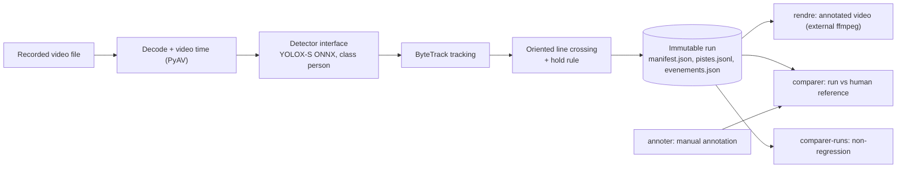

# VisionFlow

**Status: experimental prototype.** VisionFlow counts people crossing a line in a *recorded* video, on CPU,
and writes every analysis as an immutable, fully traced "run". Its counting accuracy has **not** been measured yet.

The Python package and the command line are still named `passages` (French for "passages / crossings");
VisionFlow is the public repository name, and the product name itself is an open decision (`docs/DECISIONS.md`, D-017).
Most of the design documentation is written in French.

## Motivation

Small businesses often have cameras but no simple, trustworthy way to turn footage into operational facts
("how many people came in, and when?"). VisionFlow explores that problem with three principles taken from the
decision log:

- **Video time, not wall-clock time.** Every event is dated by the position in the video (ms), never by the
  processing clock.
- **Traceability before features.** A run records the exact video, model, configuration, package versions and
  git state that produced it, and is never modified afterwards.
- **Observation is not proof.** A machine observation proves neither a sale, a payment nor any wrongdoing; a
  mismatch is only ever "a discrepancy to examine".

## Current capabilities

What the code in `passages/` does today:

| Capability | Status |
|---|---|
| Person detection with YOLOX-S (official ONNX export) on ONNX Runtime CPU | Implemented, executed on one video |
| Multi-object tracking with ByteTrack (`trackers` package by Roboflow) | Implemented, executed on one video |
| Oriented line crossing (entry / exit) with a configurable dead zone and a "hold" rule that cancels quick back-and-forth crossings | Implemented; the hold duration (1 000 ms) is a hypothesis, not a validated setting |
| Video time per frame, two explicit modes: `pts` and `rang_cadence_nominale` (display rank x nominal frame duration, marked as reconstructed time) | Implemented and unit-tested |
| Immutable runs (`runs/<run_id>/`) with a provenance manifest (hashes of video, model and configuration; versions; git commit and dirty state; timings) | Implemented |
| Annotated video rendering (`rendre`) through an external `ffmpeg` | Implemented |
| Manual annotation tool that never shows detector output (`annoter`) | Logic unit-tested; the interactive window has not been exercised |
| Comparison of a run with a human reference: missed, added, reversed, duplicates, per-minute table (`comparer`) | Unit-tested on synthetic data; **never run on a real human reference** |
| Inspection of "probable duplicate" pairs (`examiner-paires`) | Implemented |
| Technical non-regression between two runs (`comparer-runs`) | Implemented; used on real replays of the reference video |
| Model-agnostic `Detector` interface and `Detections` type, YOLOX wrapped by an adapter (class `person` only) | Implemented |

**Not implemented:** multi-class detection, live cameras / RTSP, real-time processing, multi-camera, zones,
dashboard or web interface, database (SQLite is only a proposal), human review workflow, indicators and reports.

## Architecture overview



Analysis is configured by a YAML file (`configs/s1_g420.yaml`): video path and SHA-256, time mode, crossing line in
normalised coordinates, analysis rate (10 analysed frames per second of video time), detector and tracker
parameters, hold rule. The run refuses to start if the video or model hash does not match.

## Stack

- Python 3.11 (3.11.9 used), Windows (build 10.0.26300), CPU only.
- [PyAV](https://github.com/PyAV-Org/PyAV) 18.1.0 (decoding), [NumPy](https://numpy.org/) 2.4.6,
  [OpenCV](https://opencv.org/) 4.14.0.94, [ONNX Runtime](https://onnxruntime.ai/) 1.31.1,
  [trackers](https://github.com/roboflow/trackers) 2.6.1 (ByteTrack), [supervision](https://github.com/roboflow/supervision)
  0.31.4 (only its `Detections` type), [SciPy](https://scipy.org/) 1.17.1, [PyYAML](https://pyyaml.org/) 6.0.3,
  [pytest](https://pytest.org/) 9.2.0.
- Exact direct versions: `requirements.txt`; full pinned environment: `requirements.lock`.
- External tool: `ffmpeg` on the `PATH`, only for `rendre` (annotated video).

## Prerequisites

- Python **3.11**. The pinned NumPy, SciPy and PyAV versions were chosen for 3.11 (their latest releases require
  3.12 or later; see D-013). Other Python versions are untested.
- About 530 MB of disk space for the virtual environment (measured on Windows).
- For a real analysis only: the YOLOX-S ONNX model and a video (see below). The test suite does not need them.
- For `rendre` only: `ffmpeg` on the `PATH`.

## Reproducible setup

Windows PowerShell. The environment, installation and test steps were verified on 2026-11-11 in a fresh virtual
environment (the installed packages match `requirements.lock` exactly); the `git clone` step was not, since the
repository had not been published yet.

```powershell
git clone https://github.com/bouhouchhamza/VisionFlow.git
cd VisionFlow
py -3.11 -m venv .venv
.\.venv\Scripts\python -m pip install -r requirements.lock
.\.venv\Scripts\python -m pytest -q tests -rs
```

Generic equivalent (Linux / macOS, **not verified**; `requirements.lock` was produced on Windows):

```bash
python3.11 -m venv .venv
.venv/bin/python -m pip install -r requirements.lock
.venv/bin/python -m pytest -q tests -rs
```

## Model and dataset setup

Neither the model nor any video is distributed in this repository. Download them yourself, from the original
source, under the original terms, and check their SHA-256 before use (`Get-FileHash <file> -Algorithm SHA256`).

| File | Expected location | Source | SHA-256 |
|---|---|---|---|
| YOLOX-S ONNX, release `0.1.1rc0` | `models/yolox_s.onnx` | [YOLOX releases](https://github.com/Megvii-BaseDetection/YOLOX/releases/tag/0.1.1rc0), asset `yolox_s.onnx` | `C5C2D13E59AE883E6AF3B45DAEA64AF4833A4951C92D116EC270D9DDBE998063` |
| MEVA clip `2018-03-07.16-50-01.16-55-01.school.G420.r13.avi` ("S1", tuning clip) | `data/videos/meva/` | [MEVA](https://mevadata.org/), public S3 bucket `mevadata-public-01`, key `drops-123-r13/2018-03-07/16/2018-03-07.16-50-01.16-55-01.school.G420.r13.avi` (69 804 664 bytes) | `19A8159AAE2423E4A0221BED3735BD2C61B158B02E4DFCF8A21D007796816CE4` |

`models/`, `data/`, `runs/` and all video and weight formats are excluded by `.gitignore`.

## CLI usage

All sub-commands below print their help with `--help` (checked on 2026-11-11). The "Executed on real data"
column says whether the command has actually been run on a real video in this project.

| Command | Purpose | Executed on real data |
|---|---|---|
| `analyser --config <yaml> [--runs runs] [--limite-s N] [--threads N]` | video -> detection -> tracking -> crossings -> new run | Yes (S1, 2026-11-03, plus non-regression replays) |
| `rendre --run <run_dir> [--largeur 960]` | annotated video of a run, written in `<run>/rendus/` | Yes (S1) |
| `vue-ligne --config <yaml> --t <s> --sortie <png>` | image of the line, its sides and entry direction | Yes (S1, image kept locally) |
| `annoter --config <yaml> --annotateur <name> --echantillon <id> [--passe 1]` | manual annotation, without any detector output | No (logic unit-tested only) |
| `comparer --run <run_dir> --reference <json> [--maintien-ms] [--tolerance-ms 1000]` | run vs human reference | No (unit-tested only) |
| `examiner-paires --run <run_dir> [--reference <json>]` | clues on "probable duplicate" pairs | No output found in local runs; unit-tested |
| `comparer-runs --reference <run_dir> --candidat <run_dir> [--jusqu-a-ms T]` | technical non-regression; exit code 0 only for `IDENTIQUE` | Yes |

```powershell
.\.venv\Scripts\python -m passages --help
.\.venv\Scripts\python -m passages analyser --help
.\.venv\Scripts\python -m passages comparer-runs --help
```

A full analysis requires the model and the video above:
`.\.venv\Scripts\python -m passages analyser --config configs/s1_g420.yaml`. It was not re-run for this README.

## Output format

A run is a directory `runs/<UTC timestamp>-<random>/`, written to `runs/<run_id>.tmp/` and renamed only on success.

| File | Content |
|---|---|
| `manifest.json` | run id, command, full configuration and canonical hash, video and model hashes, time report, versions, CPU, timings, summary |
| `pistes.jsonl` | one line per analysed frame: rank, video time, raw PTS, boxes, scores, track ids (-1 = unconfirmed) |
| `evenements.json` | raw crossings (machine observations), passages derived by the hold rule, probable duplicates, track start/end |

Excerpt of `manifest.json` from the reference run `20261103T172241Z-b3b507` (truncated):

```json
{
  "format": "manifeste_run",
  "run_id": "20261103T172241Z-b3b507",
  "video": { "sha256": "19A8159AAE2423E4A0221BED3735BD2C61B158B02E4DFCF8A21D007796816CE4", "verifiee": true,
             "codec": "h264", "largeur": 1920, "hauteur": 1072, "images_declarees": 9000 },
  "modele": { "chemin": "models/yolox_s.onnx", "verifie": true },
  "execution": { "images_analysees": 3000, "duree_video_analysee_s": 299.967, "duree_calcul_s": 616.164,
                 "vitesse_s_video_par_s_calcul": 0.487 },
  "resultats": { "pistes_confirmees": 24, "franchissements_bruts": 22, "passages_retenus": 14 }
}
```

Excerpt of `evenements.json` (first raw crossing, truncated):

```json
{
  "format": "evenements_passages",
  "nature": "observations_brutes_machine",
  "temps": { "mode": "rang_cadence_nominale", "debut_declare": "2018-03-07T16:50:01" },
  "franchissements": [
    { "id": "f0001", "ligne": "portes", "piste": 13, "direction": "entree", "t_ms": 2400,
      "num_image": 72, "confiance": 0.6195 }
  ],
  "passages_derives": [
    { "franchissement": "f0001", "direction": "entree", "t_ms": 2400, "statut": "annule_par_retour" }
  ]
}
```

These numbers are **unvalidated machine observations**: no human reference exists for this clip yet.

## Testing and regression

```powershell
.\.venv\Scripts\python -m pytest -q tests -rs
```

Results obtained on 2026-11-11 (Windows, Python 3.11.9):

- with the model and the S1 video present locally: **68 passed**;
- in a clean clone without `models/` and `data/`: **65 passed, 3 skipped**. The skipped tests are in
  `tests/test_detecteur.py` and need local files: two need `models/yolox_s.onnx`, one needs the model and the S1 video.

Tests use synthetic data (geometry, hold rule, time sampling, matching, annotation logic, run comparison, detector
interface). They check behaviour, not detection quality.

**Non-regression** (`comparer-runs`) compares a candidate run with a reference run: frames, tracks, crossings,
derived passages, duplicates and statistics. Verdicts: `IDENTIQUE`, `ECARTS_D_ARRONDI`, `DIFFERENT`,
`NON_COMPARABLE`. The two refactorings so far (detector interface, `Detections` type) produced replays
**identical** to the reference run. This is **technical reproducibility** (same behaviour on the same machine and
versions), **not accuracy**: identical outputs can be identically wrong.

## Project structure

```text
configs/        analysis configuration (S1)
docs/           vision, requirements, architecture, data rules, decision log, plans (French)
experiments/    E0 data inventory, E1 annotation protocol, E2 results on S1, E3 video-time checks (French)
passages/       Python package and CLI
  cli.py            sub-commands
  run.py            analysis run (decode, detect, track, cross, write run)
  detecteur.py      Detector interface, Detections type, YOLOX adapter, factory
  detection.py      YOLOX ONNX pre/post-processing (derived from YOLOX, Apache-2.0)
  crossing.py       line geometry, raw crossings, hold rule
  video.py          decoding and video time modes
  config.py, versions.py, render.py, dessin.py, annotate.py, evaluate.py, paires.py, non_regression.py
tests/          pytest suite (synthetic data; 3 tests use local model/video when present)
requirements.txt, requirements.lock
```

Not in git: `.venv/`, `models/`, `data/`, `runs/`, `reports/`, `experiments/**/out/`, `exports/`.

## Limitations

- **No accuracy measurement.** The only analysed clip (S1) has no human reference annotation. Missed, added and
  reversed crossings are unknown.
- **One clip, one view, one class.** One 5-minute indoor MEVA clip, one fixed camera, class `person` only.
  S1 is a tuning clip; any future error measured on it would be optimistic.
- **Speed measured once.** 0.49 s of video per second of compute (about 0.49x real time) on an Intel Core i7-1255U
  laptop CPU without GPU, 2026-11-03, one run. Later replays with the same configuration took longer
  (2 532 s and 2 621 s versus 616 s); the cause is not measured. No extrapolation to other machines, resolutions
  or several cameras is possible.
- **No real time, no live camera, no multi-camera.**
- **Starting parameters, not tuned ones.** Detection threshold, tracker buffer, line position and hold duration
  are starting values.
- **S1 time is reconstructed** (display rank x 1/30 s) because the AVI's raw PTS are not presentation times; the
  regularity of the original capture is an assumption.
- The interactive annotation window and `comparer` on real data have not been exercised.

## Roadmap

Planned or proposed, **not implemented**:

1. Human reference annotation of S1 (protocol E1 v2) and first error measurement (as a tuning result).
2. Multi-class support in small steps, each required to reproduce the person-only reference exactly
   (`docs/CONCEPTION_MULTICLASSE.md`; step 2 proposal: `docs/ETAPE2_DECODAGE_MULTICLASSE.md`).
3. Evaluation on held-out clips, only with a frozen configuration.
4. Proposals in `docs/IMPLEMENTATION_PLAN.md`: human review, indicators and reports, SQLite storage, recorded camera
   segments.

## Acknowledgments

- [YOLOX](https://github.com/Megvii-BaseDetection/YOLOX) by Megvii (code under Apache-2.0); pre- and post-processing
  in `passages/detection.py` are derived from it, with attribution in the source.
- ByteTrack (Zhang et al.), through the clean-room implementation in Roboflow's
  [trackers](https://github.com/roboflow/trackers) (Apache-2.0), and Roboflow's
  [supervision](https://github.com/roboflow/supervision) (MIT).
- [ONNX Runtime](https://github.com/microsoft/onnxruntime), [PyAV](https://github.com/PyAV-Org/PyAV) and FFmpeg,
  [OpenCV](https://opencv.org/), NumPy, SciPy, PyYAML, pytest.
- The MEVA dataset by Kitware Inc. and IARPA.

## Licenses and data attribution

- **VisionFlow code:** no license has been chosen yet (pending decision). Until a `LICENSE` file is added, no
  rights are granted beyond what GitHub's terms allow.
- **YOLOX weights:** the code is Apache-2.0, but **no separate license for the released weights was found**, and
  the terms of their training data (COCO) were not verified. The legal status of the weights is **not established**
  (D-022). They are not redistributed here.
- **FFmpeg:** the PyAV wheel bundles FFmpeg libraries (declared LGPL v3+, with GPL `libx264` / `libx265` DLLs);
  the external `ffmpeg` used for rendering on the development machine is a GPL v3 build (D-021, open).
- **MEVA:** if you use MEVA videos, attribution is required:
  *"Multiview Extended Video with Activities" (MEVA) dataset by Kitware Inc. and the Intelligence Advanced Research
  Projects Activity (IARPA)*, licensed under [CC BY 4.0](https://creativecommons.org/licenses/by/4.0/)
  ([license text](https://mevadata.org/resources/MEVA-data-license.txt)). CC BY 4.0 does not license privacy or
  publicity rights of the people filmed. This repository contains no MEVA video or image; the configuration and the
  numbers above refer to the clip S1.
- **CAVIAR** (EC Funded CAVIAR project/IST 2001 37540) appears in the data inventory and was used only for
  video-time checks; its license is stated as "Creative Commons BY-SA" without a version.

## Project status

Experimental prototype, developed by a single developer. Interfaces, formats and file names may change.
Nothing here has been validated for production use, for counting accuracy, or for any legal or commercial decision.
