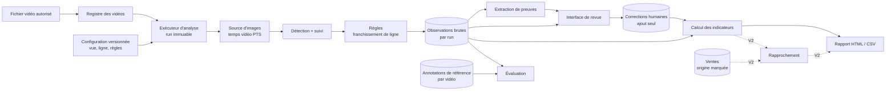

# Architecture

> Statuts : **[Confirmé]** · **[Proposition]** · **[Hypothèse]** · **[Ouvert]** (voir `VISION.md`).
> Aucun choix technique antérieur n'est considéré comme approuvé. Rien n'est encore implémenté.

Dernière mise à jour : 2026-11-03.

## 1. Contraintes qui structurent l'architecture

- **[Confirmé]** Un déploiement indépendant par entreprise, avec ses propres données.
- **[Confirmé]** Socle réutilisable ; analyses et règles configurées par client.
- **[Confirmé]** Entrée initiale : vidéos enregistrées autorisées. Caméra : plus tard, non imposée.
- **[Confirmé]** Un développeur seul.
- **[Confirmé]** Poste constaté le 2026-11-03 : Windows, Intel Core i7-1255U, 16 Go de RAM,
  GPU intégré Intel Iris Xe, aucun GPU NVIDIA détecté ; Python 3.14 (défaut) et 3.11, Node 24.15, ffmpeg 8.1.2
  installés. Leur adéquation pour l'analyse n'est pas encore mesurée.

Conséquences **[Proposition]** : un seul processus applicatif, une base de fichiers locale, pas de file de messages,
pas de conteneurs obligatoires, pas de service distant. On ajoute un composant seulement quand une mesure le justifie.

## 2. Vue d'ensemble



## 3. Modules du socle

**[Proposition]** Découpage en modules d'un même programme. Les noms sont indicatifs.

| Module | Responsabilité | V1 |
|---|---|---|
| `core` | Types du domaine (vidéo, run, observation, correction, indicateur) ; aucune dépendance technique | Oui |
| `config` | Lecture et validation des configurations ; calcul d'empreinte | Oui |
| `sources` | Interface `FrameSource` ; implémentation fichier vidéo | Oui (fichier) |
| `analysis` | Adaptateurs de détecteur et de suivi ; règles d'événements par scénario | Oui (scénario A) |
| `evidence` | Vignettes et extraits autour d'un instant | Oui |
| `store` | Base SQLite, répertoires de runs, écriture atomique | Oui |
| `review` | Interface web locale de revue | Oui |
| `indicators` | Calculs déterministes à partir d'observations + corrections | Oui |
| `reports` | Rapport HTML autonome, export CSV | Oui |
| `evaluation` | Annotations de référence, appariement, métriques | Oui |
| `reconciliation` | Import ventes, ventes synthétiques, règles d'écart | V2 |

Règle de dépendance **[Proposition]** : `core` ne dépend de rien ; `analysis` ne connaît ni la base ni l'interface ;
l'interface ne lance pas de calcul de vision elle-même. Cela permet de remplacer l'interface (option B de stack)
ou la source (caméra) sans toucher à l'analyse.

## 4. Modèle d'exécution : runs immuables

**[Proposition]**

1. Un **run** = (empreinte de la vidéo, empreinte de la configuration, version du code, identifiant et empreinte
   du modèle, paramètres). Identifiant triable dans le temps (ULID ou équivalent).
2. Les sorties d'un run sont écrites dans `runs/<run_id>.tmp/` puis renommées en `runs/<run_id>/` uniquement
   en cas de succès ; l'état en base passe alors à `reussi`. Un run `echoue` ou `annule` reste consultable
   pour diagnostic mais est exclu des indicateurs.
3. Un run réussi n'est plus jamais modifié. Retraiter = créer un nouveau run, avec `parent_run_id`.
4. Toute ligne d'observation, de preuve et de correction porte un `run_id` non nul.
5. Le **run actif** d'une vidéo pour un scénario est un pointeur explicite modifié par l'utilisateur.
6. Les corrections humaines appartiennent au run revu. Elles ne sont **pas** transférées automatiquement
   à un nouveau run en V1 (voir `DECISIONS.md` D-014).
7. Les annotations de référence (évaluation) appartiennent à la vidéo, pas à un run : elles servent à comparer
   n'importe quel run.

Détail des entités et des règles : `DATA_AND_RULES.md`.

## 5. Temps

**[Proposition]**

- Le temps d'un événement est le **temps vidéo** : horodatage de présentation (PTS) de l'image, ramené à zéro au
  début du flux, stocké en millisecondes entières. Le numéro d'image est stocké en complément, jamais utilisé
  seul pour calculer un temps (les vidéos à cadence variable le rendraient faux).
- L'heure murale d'un événement = début d'enregistrement déclaré + temps vidéo. Elle n'existe que si un début
  est déclaré, et le rapport indique sa source.
- L'horloge système ne sert qu'aux métadonnées techniques (début et fin d'un run, date d'une correction).
- **[Hypothèse]** La bibliothèque de décodage retenue fournit des PTS fiables, et l'extraction des preuves tombe
  sur l'image exacte de l'événement. Ces points sont vérifiés par E3 (`experiments/E3/PROTOCOLE.md`).
- Premiers constats d'E3, sur des mires et sur un seul fichier réel : la recherche rapide de ffmpeg et la copie sans
  réencodage peuvent renvoyer des images fausses, selon le format. Un flux sans conteneur (CAVIAR) a des PTS manquants.
  **[Proposition]** En conséquence, toute preuve est contrôlée : l'image obtenue est comparée à l'image attendue.
  **[Hypothèse]** Les fichiers sans horodatage fiable sont normalisés à l'enregistrement (H-E3-1).

## 6. Stockage

**[Proposition]** Un répertoire de données par déploiement, hors du dépôt git :

```
<data_dir>/
  db.sqlite                 # registre, runs, observations, corrections, annotations, ventes
  assets/<sha256>.<ext>     # vidéos (ou référence vers leur emplacement d'origine)
  runs/<run_id>/
    manifest.json           # entrées, versions, paramètres, empreintes, état
    evidence/               # vignettes et extraits
  reports/<report_id>.html
```

SQLite suffit pour un déploiement mono-entreprise et un utilisateur local **[Hypothèse]** ; le volume réel
d'événements par heure de vidéo sera connu après E2.

## 7. Source caméra : prévue, non réalisée

**[Proposition]** La caméra est traitée comme un **producteur de segments vidéo**, pas comme un pipeline
temps réel séparé :

1. Un futur adaptateur enregistre le flux (par exemple RTSP via ffmpeg) en segments de durée fixe.
2. Chaque segment fermé devient une vidéo du registre, avec `source_type = camera`, l'identifiant de caméra
   et l'heure murale de capture (cette fois mesurée, plus seulement déclarée).
3. Le même exécuteur d'analyse traite les segments. Le « quasi temps réel » consiste à traiter chaque segment
   dès sa fermeture.

Ce que la V1 doit respecter pour ne pas fermer cette porte :

- l'analyse lit des images via `FrameSource` (temps, numéro d'image, image), sans supposer un fichier complet ;
- la fiche vidéo porte `source_type`, `camera_id` (vide en V1) et la source de l'heure murale ;
- la géométrie est liée à un **point de vue**, réutilisable par tous les segments d'une même caméra ;
- les indicateurs agrègent sur un intervalle de temps, pas sur « une vidéo ».

**[Ouvert]** Gestion des coupures entre segments (un passage à cheval sur deux segments) : à traiter quand
la caméra sera engagée ; proposition initiale : léger recouvrement et déduplication par temps mural.

## 8. Options de stack

Deux options au maximum. Les bibliothèques citées sont des candidates ; leurs licences sont à vérifier avant
engagement (D-008).

### Option 1 — Tout Python (recommandée, toujours **[Proposition]**)

Rien n'est adopté avant les résultats d'E2 et d'E3 (D-006). Composants proposés et responsabilités :

| Composant (module) | Responsabilité | Candidat proposé | Statut |
|---|---|---|---|
| Interpréteur | Exécuter le socle | Python **3.11** (3.14 installée, disponibilité des paquets d'inférence à vérifier) | [Hypothèse] E2 |
| Décodage et temps (`sources`) | Lire les images avec leur temps vidéo et leur numéro ; signaler PTS absents ou non croissants | PyAV (liaison Python vers les bibliothèques FFmpeg) | [Proposition], à confronter à E3 |
| Normalisation à l'enregistrement (`sources`) | Remultiplexer un flux sans horodatage fiable avant analyse ; garder les deux empreintes | ffmpeg en ligne de commande | [Hypothèse] H-E3-1 |
| Extraction des preuves (`evidence`) | Vignette à l'image exacte, extrait autour de l'instant, contrôle de l'image obtenue | ffmpeg en ligne de commande, méthode choisie selon E3 | [Proposition] ; E3 montre que la copie sans réencodage et la recherche rapide ne suffisent pas |
| Inférence (`analysis`) | Exécuter un détecteur de personnes sur CPU | ONNX Runtime ; OpenVINO seulement si E2 montre un besoin | [Proposition] |
| Modèle de détection (`analysis`) | Boîtes « personne » par image | 1 à 2 candidats choisis en E2, licence lue avant l'essai (§8.1) | [Ouvert] D-008 |
| Suivi (`analysis`) | Relier les détections d'une image à l'autre (pistes locales au run) | Algorithme d'association de boîtes de type ByteTrack, implémentation à choisir | [Proposition] |
| Règle de franchissement (`analysis`) | Émettre les événements datés (`DATA_AND_RULES.md` §6) | Code du socle (pas de bibliothèque) | [Proposition] |
| Configuration (`config`) | Lire, valider, calculer l'empreinte | YAML + validation par schéma | [Proposition] |
| Stockage (`store`) | Registre, runs, observations, corrections, annotations | SQLite (module standard) + fichiers de run | [Proposition] D-007 |
| Interface de revue (`review`) | Afficher événements et preuves, enregistrer les corrections | Serveur web local, gabarits HTML, lecteur vidéo HTML5 | [Proposition] |
| Rapports (`reports`) | HTML autonome, CSV | Gabarits HTML | [Proposition] |
| Évaluation (`evaluation`) | Appariement avec les annotations, métriques | Code du socle | [Proposition] |
| Tests | Tests unitaires et de bout en bout sur fichiers de test | pytest | [Proposition] |

Les choix fins (cadriciel web, bibliothèque de validation, implémentation du suivi) se font à T1.1, après G0 ;
chacun passe par la vérification de licence du §8.1.

**Prototype du 2026-11-03** (scénario A, retenu pour le prototype uniquement) : paquet `passages/`, sans base de données
ni interface web. Python 3.11.9, PyAV 18.1.0 (temps choisi par fichier, D-023), YOLOX-S ONNX sur ONNX Runtime 1.31.1,
`trackers` 2.6.1 (ByteTrack), règle de franchissement et évaluation écrites dans le socle, ffmpeg externe pour la vidéo
annotée. Versions et licences : D-022 ; résultats : `experiments/E2/RESULTATS_S1.md`. Ce prototype ne fige pas les
modules ci-dessus pour le produit.

Avantages : un seul langage, écosystème de vision natif, peu de pièces, adapté à un développeur seul.
Inconvénients : interface de revue moins riche (frise temporelle, raccourcis clavier) qu'une application
JavaScript dédiée ; empaquetage Python sous Windows parfois délicat.

### Option 2 — Analyse Python + application web TypeScript

- Même cœur d'analyse Python, exposé en ligne de commande, écrivant dans SQLite et `runs/`.
- Application TypeScript (Node 24 déjà installé) : API légère + interface React pour la revue et les rapports.

Avantages : interface de revue plus ergonomique ; séparation nette entre analyse et produit visible.
Inconvénients : deux langages, deux chaînes d'outils, un contrat de données à maintenir des deux côtés ;
coût initial nettement plus élevé pour un développeur seul.

### Recommandation

**[Proposition]** Option 1 pour la V1, en gardant la frontière du §3 (l'interface ne lit que la base et les
fichiers de run). Si la revue devient le cœur de l'usage et que l'interface serveur montre ses limites,
passer à l'option 2 sans toucher à l'analyse. Décision à acter après E2 (D-006).

### 8.1 Licences : code, poids, données

Chaque composant d'analyse a jusqu'à **trois** licences distinctes, à lire et consigner séparément :

| Élément | Question à se poser | Exemple |
|---|---|---|
| **Code** (bibliothèque, outil) | Quelles obligations si on le modifie, le distribue au client ou le rend accessible par réseau ? | ffmpeg installé : build GPL v3 (`--enable-gpl --enable-version3`, constaté le 2026-11-03) |
| **Poids** (modèle entraîné) | Sous quelle licence l'éditeur publie-t-il les poids ? L'éditeur revendique-t-il des droits sur les modèles que l'on entraîne avec son code ? | Voir Ultralytics ci-dessous |
| **Données** (d'entraînement, d'évaluation, de démonstration) | Peut-on les utiliser pour entraîner ou évaluer ? Les montrer ? Les redistribuer ? Attribution ? | MEVA : CC BY 4.0 ; CAVIAR : CC BY-SA (version non précisée) ; voir `experiments/E0/INVENTAIRE.md` |

Règles **[Proposition]** :

- Une licence **AGPL ou GPL n'interdit pas l'usage commercial**. Elle impose des obligations : fournir le code source
  correspondant sous la même licence aux personnes à qui l'on distribue le logiciel ; avec l'AGPL, cela vaut aussi
  pour les utilisateurs qui y accèdent par réseau. Pour nous, livrer un déploiement à un client compte comme
  une distribution. Trois voies restent ouvertes : accepter de publier le code concerné sous cette licence, acheter
  une licence commerciale si l'éditeur en propose une, ou choisir un composant sous licence permissive.
  C'est une décision d'affaires (D-008), pas une interdiction.
- La **position d'un éditeur** n'est pas le texte de la licence. Ultralytics (page consultée le 2026-11-03) indique
  publier son code et ses modèles YOLO sous AGPL-3.0. Selon sa propre lecture, les modèles entraînés ou affinés avec
  son code relèvent aussi de l'AGPL, et il propose une licence Enterprise pour ne pas publier le projet.
  Cette lecture extensive est à faire examiner avant tout engagement. Elle n'empêche pas les essais internes.
- Appeler un programme externe (ffmpeg en ligne de commande) et lier une bibliothèque dans son programme ne posent pas
  les mêmes questions. Le mode d'intégration est noté pour chaque composant.
- Les poids pré-entraînés héritent d'une question sur les **données d'entraînement**. Par exemple, les conditions
  d'utilisation du jeu COCO n'ont pas pu être lues dans cette session : la page ne s'affiche pas sans JavaScript.
  Le point reste à vérifier pour chaque modèle candidat.
- Pour les essais internes (E2), tout candidat est utilisable si sa licence est consignée. La contrainte porte sur
  ce qui sera **livré** ou **montré**.

## 9. Ce qui est volontairement absent

Pas de microservices, de file de messages, de Kubernetes, de base distante, d'authentification multi-utilisateur,
de GPU dédié ni de flux temps réel en V1. Chacun pourra être ajouté si une mesure ou un client réel le justifie.
