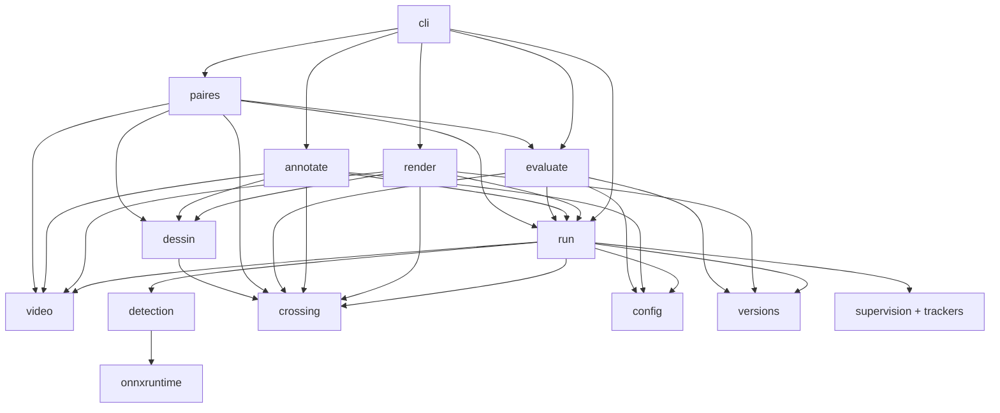
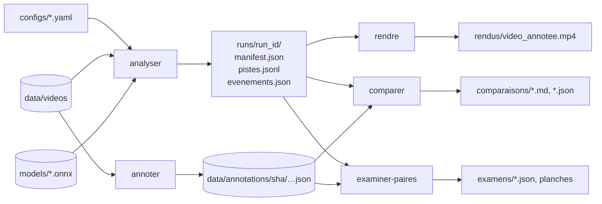
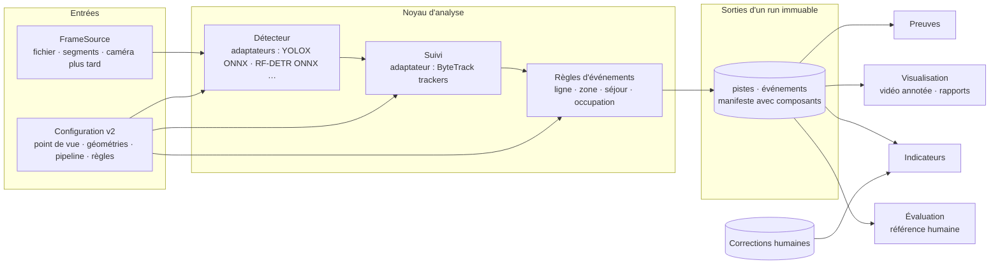

# Audit architectural et proposition d'évolution vers une plateforme de Video Analytics

> Statuts : **[Confirmé]** · **[Proposition]** · **[Hypothèse]** · **[Ouvert]** (voir `VISION.md`).
> Ce document est un **audit et une proposition**. Rien n'y est décidé : chaque choix passe ensuite par
> `DECISIONS.md`. Aucune ligne de code ni de configuration n'a été modifiée pour le produire.

Date : 2026-11-11. État audité : commit `d73403c` (arbre de travail propre), run S1 `20261103T172241Z-b3b507`.

## 0. Résumé

- **[Confirmé]** Le prototype `passages/` (≈ 1 900 lignes de Python, 27 tests N0) fait tourner une chaîne complète
  sur un fichier : temps vidéo → détection YOLOX-S → suivi ByteTrack → franchissement de ligne → événements JSON →
  vidéo annotée, avec runs immuables et manifeste. Il est mesuré en vitesse sur S1, **pas en justesse** : aucune
  annotation humaine n'existe encore, donc aucune erreur n'est mesurée.
- **[Confirmé]** Les briques les plus réutilisables pour une plateforme générale sont la **gestion du temps vidéo**
  (`video.py`), le **modèle de run immuable** (`run.py`, `versions.py`, `config.py`), la **géométrie et la règle de
  franchissement** (`crossing.py`, indépendant du détecteur) et l'**appariement d'évaluation** (`evaluate.py`).
- **[Confirmé]** Remplacer YOLOX demande aujourd'hui de modifier `run.py`, `detection.py`, `config.py` et la
  configuration : il n'existe ni interface de détecteur, ni notion de classe, ni description du détecteur dans le
  manifeste. Douze couplages sont listés au §4 ; un seul est bloquant à lui seul (instanciation directe).
- **[Proposition]** Architecture cible : un **noyau de pipeline par étapes** (source → détection → suivi → règles →
  sorties) avec des **adaptateurs** déclarés en configuration, un **modèle d'événement générique**, et le reste du
  plan existant (stockage, revue, indicateurs, rapports) branché en aval. Pas de réécriture : extraction progressive
  du code actuel, chaque étape vérifiée par un **test de non-régression sur le run S1**.
- **[Proposition]** Composants externes : garder `trackers` (ByteTrack) et `supervision` en périphérie ;
  **RF-DETR** est le candidat le plus pertinent pour un second détecteur, mais seulement les tailles sous Apache-2.0
  et dans un environnement séparé ; **CVAT** et **Frigate** ne sont pas utiles maintenant (§5).
- **[Confirmé]** Contrainte matérielle mesurée : sur ce portable sans GPU, un seul flux S1 est analysé à
  **0,49 s de vidéo par seconde de calcul** (10 images analysées par seconde). Toute ambition temps réel ou
  multi-caméra exige d'autres mesures et probablement un autre matériel ; rien n'est extrapolé ici.
- **Prochaine étape inchangée** : l'annotation humaine de S1 et la comparaison. Toute la feuille de route du §8
  commence après.

## 1. Périmètre et méthode

Fait : lecture du code, des imports, de la configuration, des sorties du run S1 (taille des fichiers seulement) ;
vérification en ligne, le 2026-11-11, des licences et des dépendances déclarées des composants cités (fichiers
`LICENSE`, `README` et métadonnées PyPI).

Pas fait, conformément à la demande : aucune modification de code, de configuration, de YOLOX, du suivi, des lignes
ou des seuils ; aucun benchmark ni optimisation ; aucun accès à R1 ni R2 ; aucune installation ; aucun commit.

Limites de l'audit : les composants externes sont jugés sur leur documentation, pas sur un essai. Les affirmations
de performance des éditeurs (par exemple les latences de RF-DETR) ne sont pas reprises comme des faits pour ce poste.

## 2. Architecture actuelle

### 2.1 Modules

| Module | Lignes | Rôle | Dépendances externes |
|---|---|---|---|
| `video.py` | 163 | Décodage, temps vidéo (`pts` ou `rang_cadence_nominale`), bilan des horodatages, échantillonnage sur le temps vidéo | PyAV |
| `detection.py` | 89 | Détecteur YOLOX ONNX : prétraitement, décodage des sorties, NMS, classe personne | ONNX Runtime, OpenCV, NumPy |
| `crossing.py` | 193 | Ligne orientée, côté, intersection de segment, franchissements bruts, règle de maintien, doublons probables | aucune |
| `run.py` | 208 | Orchestration de l'analyse, suivi (création du `ByteTrackTracker`), écriture `pistes.jsonl`, `evenements.json`, `manifest.json`, dossier `.tmp` renommé | supervision, trackers, NumPy |
| `config.py` | 85 | Lecture YAML, validation, empreintes canonique et fichier | PyYAML |
| `versions.py` | 72 | Versions des paquets, processeur, commit et état git | — |
| `render.py` | 118 | Vidéo annotée (second décodage + ffmpeg externe) | OpenCV, ffmpeg |
| `dessin.py` | 53 | Tracés communs (ligne, côtés, flèche, textes) | OpenCV |
| `annotate.py` | 367 | Outil d'annotation manuelle (OpenCV), sans affichage du détecteur | PyAV, OpenCV |
| `evaluate.py` | 310 | Référence humaine, règle de maintien des deux côtés, appariement un pour un, rapport | SciPy |
| `paires.py` | 209 | Examen des paires « doublon probable » (indices, planches) | OpenCV |
| `cli.py` | 108 | Commandes `analyser`, `rendre`, `vue-ligne`, `annoter`, `comparer`, `examiner-paires` | — |

Hors paquet : `experiments/E3/controle_temps.ps1` (contrôle ffmpeg des horodatages et des extraits) et
`experiments/E3/controle_lecteur.py` (contrôle du lecteur d'annotation).

### 2.2 Dépendances internes



Constats :
- `crossing.py` et `video.py` ne dépendent d'aucun autre module du paquet : ce sont les meilleures bases d'un noyau.
- `run.py` est à la fois **orchestrateur** et **bibliothèque** (`RACINE`, `charger_run`, `ecrire_json` sont importés
  par quatre modules) : c'est le point de couplage central.
- Aucun module `core` de types partagés : les échanges se font par dictionnaires et par les formats de fichiers.

### 2.3 Flux de données



Volumes observés sur S1 (300 s de vidéo, 3 000 images analysées) : `pistes.jsonl` 536 ko, `evenements.json` 15 ko,
`manifest.json` 5 ko, vidéo annotée 12,3 Mo. Ce sont des valeurs d'une scène presque vide après 17 s ; elles ne
prédisent pas le volume d'une scène dense.

### 2.4 Ce qui est solide

- Datation par temps vidéo, mode de temps déclaré par fichier et refus explicite des cas non sûrs (D-023).
- Runs immuables : écriture dans `.tmp`, renommage au succès, empreintes de la vidéo, du modèle et de la
  configuration, commit et état git (depuis `d73403c`).
- Séparation observations brutes (franchissements) / règle dérivée (maintien, hypothèse) / évaluation.
- Évaluation qui sépare manqués, ajouts, sens inversés et doublons, avec sensibilité au maintien.
- Référence humaine produite sans affichage du détecteur.

## 3. Réutilisation pour une plateforme générale

Légende : **Tel quel** = réutilisable sans changement de comportement ; **À extraire** = la logique est bonne mais
enfermée dans un module trop spécifique ; **Spécifique** = propre au scénario A ou au prototype.

| Capacité | Code actuel | Réutilisation | Ce qui manque pour être général |
|---|---|---|---|
| Source et temps vidéo | `video.py` | **Tel quel** comme source « fichier » | Interface `FrameSource` ; source par segments ou par caméra ; mode de temps « heure de capture » pour une caméra |
| Échantillonnage | `Echantillonneur` | **Tel quel** | Échantillonnage conditionnel (mouvement), plusieurs cadences par règle |
| Détection | `detection.py` | **À extraire** : devient l'adaptateur YOLOX | Interface de détecteur, classes multiples, description du modèle dans le manifeste |
| Suivi | `creer_traqueur` dans `run.py` | **À extraire** : devient l'adaptateur ByteTrack | Interface de suivi, suivi par classe, paramètres documentés par détecteur |
| Lignes | `Ligne` dans `crossing.py` | **Tel quel** | Lignes multiples testées sur données réelles ; ligne liée à un point de vue réutilisable |
| Franchissements et maintien | `DetecteurFranchissements`, `appliquer_maintien` | **Tel quel**, indépendant de la classe | Ancrage choisi par classe (personne : bas de boîte ; autre : centre…) |
| Zones (polygones) | — | Non implémenté | Règles présence, entrée/sortie de zone, durée de séjour, occupation |
| Événements | `evenements.json` v1 | **Spécifique** au franchissement | Modèle générique : type, règle, géométrie, piste, classe, temps, attributs |
| Statistiques | compteurs cumulés dans `render.py`, tableau par minute dans `evaluate.py` | **À extraire** | Module d'indicateurs à partir des événements et des corrections (`DATA_AND_RULES.md` §7) |
| Configuration | `config.py` | Mécanique **tel quel** (empreintes) ; schéma **spécifique** | Schéma v2 : sources, géométries, pipeline, règles, sorties ; refus des clés inconnues |
| Visualisation | `dessin.py`, `render.py`, `vue-ligne` | **À extraire** | Zones, classes, couleurs par règle ; rapport HTML ; tableau de bord hors périmètre actuel |
| Preuves | méthode validée par E3, non intégrée | Non implémenté dans le paquet | Module `evidence` (vignette et extrait réencodé, contrôle de l'image obtenue) |
| Annotation | `annotate.py` | **Spécifique** aux franchissements | Annotation de zones et de classes ; interopérabilité éventuelle avec CVAT |
| Évaluation | `evaluate.py` | Appariement **tel quel** (tout événement daté) ; maintien **spécifique** | Métriques par type d'événement ; métriques de suivi si une vérité terrain par boîte existe |
| Runs et traçabilité | `run.py`, `versions.py` | **Tel quel** | Description des composants (type, version, classes, prétraitement) dans le manifeste |

## 4. Couplages qui empêchent de remplacer YOLOX

| # | Couplage | Où | Effet | Remède proposé |
|---|---|---|---|---|
| C1 | Import et instanciation directe de `DetecteurYolox`, avec des arguments propres à YOLOX | `run.py` l. 19 et 72-73 | **Bloquant** : un autre détecteur impose de modifier l'orchestrateur | Interface `Detecteur` + fabrique choisie par `detecteur.type` |
| C2 | Classe « personne » codée en dur (`CLASSE_PERSONNE = 0`, score = objectness × classe 0) | `detection.py` l. 13 et 50 | Une seule classe possible ; aucun identifiant de classe en sortie | Le détecteur rend `(boîtes, scores, classes)` ; la liste des classes vient de la configuration |
| C3 | `class_id` forcé à 0 avant le suivi | `run.py` l. 103-104 | Suivi et événements supposent une seule classe | Transporter la classe jusqu'aux pistes et aux événements |
| C4 | Schéma de configuration propre à YOLOX : `seuil_nms` exigé par la validation, `modele.taille_entree` lu sans défaut par l'orchestrateur ; `scenario` limité à `comptage_passages` | `config.py` l. 56-57 et 79, `run.py` l. 72 | Un détecteur sans NMS (famille DETR) ou un autre scénario sont refusés | Section `detecteur` libre par type, validée par l'adaptateur |
| C5 | Seuils calibrés sur la distribution des scores YOLOX : `seuil_detection` 0,1, seuils du suivi 0,5 | `configs/s1_g420.yaml` | Les seuils ne se transfèrent pas à un autre détecteur ; résultats non comparables sans re-réglage | Seuils rangés avec le détecteur ; comparaison de détecteurs sur la même référence, chaque détecteur avec ses propres seuils |
| C6 | Ancrage « bas-centre » codé en dur ; la clé `point_ancrage` de la configuration n'est **lue nulle part** et aucune clé inconnue n'est refusée | `run.py` l. 117, `config.py` | Paramètre déclaré mais sans effet ; ancrage inadapté à d'autres objets | Lire l'ancrage depuis la configuration ; rejeter les clés inconnues (avec maintien du résultat S1) |
| C7 | Contrat d'image implicite : tableau BGR pleine résolution | `run.py`, `detection.py` | Un détecteur RVB ou normalisé doit refaire la conversion | Contrat explicite dans l'interface ; conversion dans l'adaptateur |
| C8 | Le manifeste décrit le modèle par chemin et empreinte seulement | `run.py` (manifeste) | Deux runs de détecteurs différents ne sont pas auto-descriptifs | Bloc `composants` : type, version, classes, résolution, prétraitement, seuils |
| C9 | `pistes.jsonl` sans classe ni nom de détecteur | `run.py`, lu par `render.py` et `paires.py` | Rendu et examen ne savent pas distinguer les classes | Format v2 avec `classe` ; lecteurs compatibles v1 |
| C10 | Exécution limitée à ONNX Runtime, réglages de session dans l'adaptateur | `detection.py` | Un détecteur publié pour PyTorch exige soit un export ONNX, soit PyTorch dans l'environnement | Règle : tout détecteur entre par un export ONNX vérifié, ou par un environnement séparé |
| C11 | Boucle d'analyse monolithique (décodage, détection, suivi, règles, écritures et manifeste dans une seule fonction) | `run.analyser` | Ajouter une zone ou une seconde règle oblige à modifier la boucle | Étapes séparées et liste de règles en configuration |
| C12 | `run.py` sert de bibliothèque commune (`RACINE`, `charger_run`, `ecrire_json`) | quatre modules | Toute évolution de l'orchestrateur touche le rendu, l'annotation et l'évaluation | Déplacer ces fonctions dans un module `stockage_runs` |

Non couplés au détecteur : `crossing.py`, `video.py`, l'appariement d'`evaluate.py`, `versions.py`.

## 5. Composants open source examinés

Vérifications faites le 2026-11-11 sur les dépôts et PyPI. « Non vérifié » signifie que l'information n'a pas été lue
à la source.

| Composant | Ce que c'est | Licence (vérifiée) | Apport possible | Coûts et risques | Proposition |
|---|---|---|---|---|---|
| **Supervision** (Roboflow) | Bibliothèque d'outils : type `Detections`, zones de ligne et de polygone, annotateurs | MIT ; 0.31.4 installée | Annotateurs pour une visualisation plus riche ; géométrie de polygone | A déjà retiré ByteTrack d'une version à l'autre : API instable. Ses compteurs de ligne n'ont ni maintien en ms ni temps vidéo | **Garder en périphérie** (format d'échange avec le suivi), ne pas en faire le format interne ; garder nos règles |
| **ByteTrack** | Algorithme de suivi. Code de recherche d'origine : `ifzhang/ByteTrack` | Original : MIT. Utilisé : `trackers` (Roboflow), Apache-2.0, 2.6.1 installée, 2.7.0 publiée (ajoute `jsonargparse`) | Déjà en place, accepte le temps vidéo | Comportement d'une réimplémentation ; le délai de perte dépend de `lost_track_buffer / 30` | **Garder `trackers`** derrière une interface ; ne pas reprendre le code de recherche d'origine |
| **RF-DETR** (Roboflow) | Détecteur de la famille DETR (sans NMS), réglable par apprentissage | Paquet `rfdetr` : Apache-2.0. Poids de détection Nano, Small, Medium, Large : Apache-2.0 selon le README. Poids Atto, Femto, Pico, XL, 2XL (`rfdetr[plus]`) : **PML 1.0**, l'auto-hébergement commercial exige une option payante | Second détecteur à comparer ; réglage fin pour des classes de ports ou de routes | `rfdetr` 1.12.0 exige PyTorch ≥ 2.2, torchvision, transformers ≥ 5.1 et `pyDeprecate` < 0.10 : environnement lourd, et rétrogradation de `pyDeprecate` par rapport au verrou actuel. Latences publiées **sur GPU T4 avec TensorRT** : aucun chiffre CPU. Provenance des poids (dorsale DINOv2, données d'entraînement) non vérifiée | **Candidat n° 1** pour un second détecteur, plus tard : tailles Apache-2.0 seulement, environnement séparé, export ONNX à vérifier, même référence S1 |
| **CVAT** | Plateforme d'annotation d'images et de vidéos (boîtes, pistes, polygones) | Cœur « Community » : MIT. Le README signale que certains composants (modèles « serverless ») ont d'autres licences | Vérité terrain par boîte ou par piste (métriques de suivi), jeux d'apprentissage pour un réglage fin | Déploiement Docker (sous Windows : WSL2), service à maintenir. Notre référence E1 porte sur des **instants de franchissement**, que l'outil maison saisit plus vite | **Pas maintenant.** Interopérabilité (export et import) quand un réglage fin ou une évaluation du suivi sera décidé |
| **Frigate** | Enregistreur vidéo réseau complet pour caméras IP : détection en temps réel, déclenchée par le mouvement, zones et masques, enregistrement, MQTT, Home Assistant | MIT (copyright Frigate, Inc., marque déposée « Frigate™ ») | Couche d'acquisition caméra (enregistrement, segments) le jour où une caméra est engagée ; exemples de configuration de zones | C'est une **application**, pas une bibliothèque. Elle privilégie le temps réel plutôt que le traitement de chaque image, à l'opposé de nos principes de datation et d'évaluation. Accélérateur ou GPU « fortement recommandé » par l'éditeur. Licences des modèles qu'il fournit : non vérifiées | **Pas d'intégration.** À réexaminer en phase caméra (E6), comme source de segments, pas comme moteur d'analyse |

Composants déjà prévus et toujours valables : ONNX Runtime (MIT) ; OpenVINO, mentionné dans `ARCHITECTURE.md` §8 pour
le GPU intégré Intel, reste une piste à mesurer, pas une décision. Ultralytics YOLO reste écarté pour le prototype
(AGPL-3.0, D-008) : ce n'est pas une interdiction, c'est une obligation de publier le code qui n'est pas nécessaire.

## 6. Capacités : implémentées, partielles, absentes

**Implémenté** = présent dans le code et vérifié (mesure réelle ou test N0, précisé). **Partiel** = présent mais
limité ou non vérifié sur données réelles. **Non implémenté** = absent.

| Capacité | Statut | Preuve ou limite |
|---|---|---|
| Lecture de fichier avec temps vidéo (deux modes) | Implémenté | E3 §4.3 sur S1 ; régularité de la capture : hypothèse |
| Échantillonnage sur temps vidéo | Implémenté | Test N0 |
| Détection de personnes YOLOX-S sur CPU | Implémenté | Exécuté sur S1 ; justesse **non mesurée** |
| Suivi ByteTrack | Implémenté | Exécuté sur S1 ; justesse non mesurée |
| Franchissement de ligne orienté, marge, segment | Implémenté | Tests N0 ; exécuté sur S1 |
| Règle de maintien (hypothèse) et sensibilité | Implémenté | Tests N0 |
| Runs immuables, manifeste, traçabilité git | Implémenté | Run S1 (sans commit, antérieur) ; commit enregistré depuis `d73403c` |
| Reproductibilité | Partiel | Vérifiée sur 20 s seulement, même poste |
| Vidéo annotée | Implémenté | 3 000 images vérifiées par ffprobe |
| Outil d'annotation manuelle | Partiel | Logique testée, lecteur contrôlé (48/48) ; fenêtre et touches jamais exercées |
| Comparaison avec la référence humaine | Partiel | Tests N0 seulement ; **jamais exécutée sur une vraie référence** |
| Examen des paires suspectes | Partiel | Tests N0 seulement ; pas encore exécuté sur S1 |
| Lignes multiples | Partiel | Prévu par le code et la configuration ; jamais exercé |
| Configuration versionnée | Partiel | Empreintes faites ; schéma limité au scénario A ; clé `point_ancrage` ignorée |
| Statistiques | Partiel | Compteurs cumulés dans le rendu, tableau par minute dans l'évaluation ; aucun module d'indicateurs |
| Extraction de preuves | Partiel | Méthode validée par E3 (script ffmpeg) ; pas intégrée au paquet |
| Interface de détecteur, autre détecteur | Non implémenté | — |
| Classes multiples (véhicules, bateaux…) | Non implémenté | — |
| Interface de suivi, autre suivi | Non implémenté | — |
| Zones, présence, durée de séjour, occupation | Non implémenté | — |
| Modèle d'événement générique | Non implémenté | — |
| Source caméra, segments, RTSP | Non implémenté | Conception dans `ARCHITECTURE.md` §7 |
| Stockage SQLite, revue humaine, corrections | Non implémenté | Phases 1 et 2 du plan |
| Indicateurs, rapports HTML et CSV | Non implémenté | Phase 3 du plan |
| Vitesse, distance (calibration du sol) | Non implémenté | — |
| Floutage | Non implémenté | D-012 ouvert |
| Tableau de bord, alertes, multi-caméra | Non implémenté | Hors périmètre actuel |

## 7. Architecture cible proposée **[Proposition]**

### 7.1 Principes

1. **Prolonger, pas remplacer** : l'architecture de `ARCHITECTURE.md` (modules `core`, `sources`, `analysis`,
   `evidence`, `store`, `review`, `indicators`, `reports`, `evaluation`) reste la cible du produit. Cet audit précise
   comment le module `analysis` devient extensible.
2. **Un noyau de pipeline, des adaptateurs** : le noyau ne connaît que des interfaces et des types ; chaque
   détecteur, suivi ou règle est un adaptateur enregistré par nom dans une table interne. Pas de chargement dynamique
   de greffons tiers tant qu'un besoin réel ne l'exige pas.
3. **La configuration choisit, le code ne devine pas** : type de détecteur, classes, ancrage, règles et sorties sont
   déclarés ; toute clé inconnue est refusée.
4. **Chaque refactorisation est neutre** : elle doit reproduire les sorties du run S1 à l'identique, hors
   identifiant de run et métadonnées de date (test de non-régression « S1 »).
5. **Le secteur est une configuration, pas une branche de code** : commerces, cafés, routes et ports diffèrent par
   les classes, les géométries, les règles et le modèle, pas par le noyau.

### 7.2 Vue d'ensemble



### 7.3 Contrats proposés

- `Image` : rang, temps vidéo (ms), indicateur de temps reconstruit, tableau d'image et son format déclaré.
- `Detecteur` : `decrire()` (type, version, empreinte, classes, résolution, prétraitement) et
  `detecter(image) -> Detections` ; `Detections` = boîtes, scores, **classes**.
- `Suivi` : `mettre_a_jour(detections, t_s) -> PistesObservees` (piste, classe, boîte, score).
- `Regle` : `observer(pistes, image) -> evenements` ; règles initiales : `franchissement_ligne` (le code actuel) ; plus
  tard `zone_entree_sortie`, `sejour_zone`, `occupation_zone`.
- `Evenement` (format v2) : identifiant, type, règle, géométrie, piste, classe, `t_ms`, `num_image`, borne
  d'incertitude, attributs propres au type. Les franchissements actuels s'y transposent sans perte.
- `Sortie` : écrivains `pistes.jsonl`, `evenements.json`, manifeste ; plus tard base SQLite (D-007).

### 7.4 Configuration v2 (esquisse, non appliquée)

```yaml
version_schema: 2
point_de_vue: g420_portes
source: {type: fichier, chemin: …, sha256: …, mode_temps: rang_cadence_nominale}
geometries:
  lignes: [{id: portes, p1: […], p2: […], sens: {…}}]
  zones: []
pipeline:
  cadence_analyse: 10
  detecteur: {type: yolox_onnx, modele: {…}, classes: [personne], seuils: {score: 0.1, nms: 0.45}}
  suivi: {type: bytetrack_trackers, parametres: {…}}
regles:
  - {type: franchissement_ligne, ligne: portes, classes: [personne], ancrage: bas_centre, maintien_ms: 1000}
sorties: [pistes_jsonl, evenements_json]
```

La configuration v1 de S1 doit rester lisible : la conversion v1 → v2 doit donner les mêmes résultats.

### 7.5 Adaptation par secteur (à mesurer, rien n'est promis)

| Secteur | Objets et règles probables | Points durs prévisibles |
|---|---|---|
| Commerce, café | Personnes ; lignes d'entrée, zones de comptoir, files, durée de séjour | Occultations, groupes, reflets ; vie privée (D-016, D-018) |
| Routes | Voitures, camions, bus, deux-roues (classes COCO existantes) ; lignes par voie et par sens | Vitesse et distance demandent une calibration du sol ; nuit, pluie ; plaques = données personnelles (hors périmètre) |
| Ports | Camions, bateaux, personnes en zone interdite ; portails, quais | Objets petits ou lointains, très grandes images, météo ; classes absentes de COCO (conteneurs, engins) qui exigent des données et un réglage fin ; cadre de sûreté portuaire |

## 8. Feuille de route incrémentale **[Proposition]**

Chaque étape tient en une à deux sessions, garde le code existant, et se termine par une vérification. Le gel
actuel (détecteur, suivi, ligne, seuils) est maintenu jusqu'à la fin de l'étape 0.

| Étape | Objet | Dépend de | Critère d'acceptation | Vérification |
|---|---|---|---|---|
| **0** | Annotation humaine de S1, comparaison, examen des 14 paires (déjà prévu, `experiments/E2/RESULTATS_S1.md` §5) | Votre passe 1 | Erreurs localisées par catégorie | Rapports dans `runs/…/comparaisons` et `examens` |
| **1** | Test de non-régression S1 : relancer l'analyse avec la configuration actuelle et comparer `pistes.jsonl` et `evenements.json` au run de référence | 0 | Contenus identiques hors `run_id` et dates | Script de comparaison ; ce n'est ni un benchmark ni un réglage |
| **2** | Module `stockage_runs` (`RACINE`, `charger_run`, `ecrire_json`) sorti de `run.py` (C12) | 1 | Aucune différence de sortie | Test S1 + 27 tests |
| **3** | Types `Image` et `Detections` (avec classes), interface `Detecteur`, adaptateur YOLOX qui enveloppe le code actuel, fabrique par `type` (C1, C2, C7) | 2 | Sorties S1 identiques ; configuration v1 toujours acceptée | Test S1 ; test N0 d'un faux détecteur |
| **4** | Classes transportées jusqu'aux pistes et aux événements ; ancrage lu depuis la configuration ; clés inconnues refusées (C3, C6, C9) | 3 | Sorties S1 identiques pour la classe personne et l'ancrage bas-centre | Test S1 ; test N0 multi-classe |
| **5** | Interface `Suivi` et adaptateur ByteTrack (`trackers`) | 3 | Sorties S1 identiques | Test S1 |
| **6** | Découpage de `analyser` en étapes et liste de règles (C11) ; bloc `composants` dans le manifeste (C8) | 4, 5 | Sorties S1 identiques ; manifeste auto-descriptif | Test S1 ; lecture du manifeste |
| **7** | Format d'événement v2 et configuration v2 avec conversion depuis v1 ; `comparer`, `rendre` et `examiner-paires` lisent v1 et v2 | 6 | Le run S1 v1 reste comparable ; un nouveau run v2 donne les mêmes franchissements | Tests N0 ; test S1 |
| **8** | Règles de zone (entrée/sortie, séjour, occupation) en tests N0 ; protocole d'annotation de zone écrit **avant** toute mesure | 7 | Tests N0 ; protocole relu | Tests |
| **9** | Expérience « second détecteur » : RF-DETR (tailles Apache-2.0), environnement séparé, export ONNX vérifié, adaptateur ; entrée préalable dans `DECISIONS.md` | 3, 0 | Comparaison sur la même référence S1, chaque détecteur avec ses seuils ; résultats marqués « réglage » | Rapports de comparaison ; vitesse mesurée à part, sans extrapolation |
| **10** | Module d'indicateurs (comptes par intervalle, sens, classe ; occupation et séjour quand les zones existent) | 7 | Calcul déterministe à partir des événements et des corrections | Tests N0 |
| **11** | Visualisation généralisée (zones, classes) et intégration des preuves selon la méthode E3 | 7 | Image de preuve exacte contrôlée par empreinte | Contrôle E3 rejoué sur S1 |
| **12** | Gel d'une première configuration (empreinte notée), puis **première** évaluation sur R1 et R2 | 0 et choix consigné | Évaluation consignée, même mauvaise | Règles de la réserve (D-020) |
| **13+** | Plan existant : SQLite, revue et corrections, rapports (phases 1 à 3) ; source par segments, puis caméra (E6, réexamen de Frigate) ; interopérabilité CVAT si un réglage fin est décidé ; essais par secteur avec des vidéos autorisées | 12 | Selon `IMPLEMENTATION_PLAN.md` | Portes G0 à G2 |

Ordre justifié : les étapes 1 à 7 ne changent aucun résultat. Elles réduisent le coût de toute expérience future sans
toucher au protocole S1. Les étapes qui changent des résultats (9, 12) viennent après la mesure de l'étape 0.

## 9. Risques, contraintes matérielles, licences

### 9.1 Risques techniques

| Risque | Effet | Atténuation proposée |
|---|---|---|
| Aucune mesure d'erreur à ce jour | Toute décision d'architecture sur le détecteur serait aveugle | Étape 0 d'abord |
| Régression silencieuse pendant la refactorisation | Résultats S1 altérés sans le savoir | Test de non-régression S1 à chaque étape |
| Scores non comparables entre détecteurs (C5) | Comparaison biaisée | Seuils propres à chaque détecteur, même référence, même règle |
| Temps d'une caméra différent de celui d'un fichier | Datation fausse en direct | Mode de temps « capture » à concevoir avec E6 ; l'hypothèse 30 i/s reste propre à S1 |
| Changement de domaine (nuit, météo, petits objets, classes hors COCO) | Rappel faible dans les ports et sur les routes | Mesure par secteur avant toute promesse ; réglage fin seulement avec données autorisées et annotées |
| Instabilité des API externes (supervision a retiré ByteTrack) | Casse à la mise à jour | Adaptateurs minces, versions figées, tests |
| Poids de PyTorch (RF-DETR natif) | Environnement lourd, conflits de versions | Environnement séparé ; production par ONNX si l'export est vérifié |
| Fin de maintenance de Python 3.11 (octobre 2027) | Montée de version contrainte | À planifier ; `rfdetr` et `trackers` acceptent ≥ 3.10 |
| Complexité de la configuration v2 | Erreurs de paramétrage | Schéma strict, refus des clés inconnues, vue de contrôle de chaque géométrie |
| Dérive vers un « Frigate maison » temps réel | Perte de la datation précise et de l'évaluation | Garder le traitement par segments (D-009) tant qu'aucun besoin mesuré n'exige autre chose |
| Développeur seul | Dispersion | Une étape à la fois, chacune neutre ou mesurée |

### 9.2 Contraintes matérielles

- **[Confirmé]** Poste : Intel Core i7-1255U, 15,7 Go de RAM, Iris Xe, pas de GPU NVIDIA.
- **[Confirmé]** Mesure unique sur S1 : détection YOLOX-S 640×640 ≈ 189 ms par image, débit global 0,49 s de vidéo
  par seconde de calcul à 10 images analysées par seconde. La vitesse a baissé pendant le run, sans cause mesurée.
  Mémoire maximale non mesurée.
- **Conséquence factuelle** : ce poste n'analyse pas un seul flux en temps réel avec cette configuration.
  Plusieurs caméras ou un détecteur plus gros demandent de nouvelles mesures et, probablement, un matériel
  d'inférence (GPU, NPU ou accélérateur). Leviers à mesurer plus tard, sans engagement : cadence d'analyse, détection
  déclenchée par le mouvement, résolution d'entrée, OpenVINO sur Iris Xe, quantification.
- Aucune optimisation n'est proposée avant la localisation des erreurs (étape 0).

### 9.3 Licences et conditions à vérifier

| Élément | État | À faire |
|---|---|---|
| Poids YOLOX-S `0.1.1rc0` | **Non établi** : aucune licence distincte trouvée (D-022) | Question au dépôt ou avis juridique avant tout usage hors essai |
| Données COCO (entraînement de YOLOX et RF-DETR) | Non vérifié | Lire les conditions (images Flickr, annotations) |
| RF-DETR | Code et tailles N/S/M/L : Apache-2.0 selon le README ; A/F/P/XL/2XL : PML 1.0 | Ne retenir que les tailles Apache-2.0 ; vérifier la licence dans les métadonnées de chaque fichier de poids téléchargé ; vérifier la dorsale DINOv2 et les données d'entraînement |
| `trackers`, supervision, ONNX Runtime, OpenCV, PyAV (code) | Licences permissives constatées | Suivre les changements de version |
| FFmpeg embarqué par PyAV (déclaré LGPL, contient libx264 et libx265) ; ffmpeg externe GPL | Ouvert (D-021) | À trancher avant toute livraison |
| CVAT | Cœur MIT ; certains modèles « serverless » sous d'autres licences | Vérifier chaque modèle branché |
| Frigate | MIT, marque déposée | Vérifier les modèles fournis et l'usage du nom |
| Ultralytics YOLO | AGPL-3.0 et lecture extensive de l'éditeur (D-008) | Seulement si les obligations sont acceptées ou une licence achetée |
| Vidéos publiques (MEVA CC BY 4.0, CAVIAR, Pexels) | Vérifié en E0, usage interne | Respecter attribution et restrictions ; pas d'illustration d'« écart à examiner » avec Pexels |
| Données des clients (personnes, plaques, sites portuaires) | Ouvert (D-016, D-018) | Cadre juridique par secteur avant tout pilote |

## 10. Décisions qui seraient à consigner (non prises ici)

- Adopter l'architecture de pipeline à adaptateurs du §7 (prolonge D-006, n'engage pas le produit sur une stack).
- Adopter le test de non-régression S1 comme condition de toute refactorisation.
- Règle d'entrée d'un nouveau détecteur : licence du code, des poids et des données consignée, export ONNX vérifié
  ou environnement séparé, même référence d'évaluation.
- Statut de Supervision (périphérie) et de `trackers` (adaptateur), mise à jour éventuelle vers 2.7.0.
- Rejet, pour l'instant, de l'intégration de CVAT et de Frigate, avec leurs conditions de réexamen.
